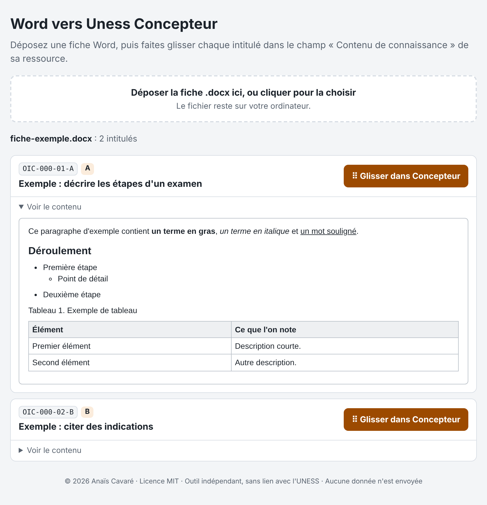

# Word vers Uness Concepteur

Application web qui modifie une fiche MONA rédigée sous Word pour la déposer, intitulé par intitulé, dans Uness Concepteur sans perdre sa mise en forme.

## Contexte

Dans Uness Concepteur, le champ « Contenu de connaissance » transforme tout collage en texte brut. Une fiche copiée depuis Word perd ses titres, son gras, ses listes et ses tableaux, qu'il faut ensuite refaire à la main avec la barre d'outils. Cet éditeur conserve en revanche la mise en forme d'un contenu glissé-déposé. 

Cette application lit la fiche Word, la découpe par intitulé et propose pour chaque intitulé un bouton à faire glisser dans la ressource correspondante.

## Utilisation

L'application est contenue dans le fichier `index.html`. On peut l'ouvrir en ligne à l'adresse https://acavare.github.io/conversion-UNESS-Concepteur/, ou la télécharger (bouton « Code », puis « Download ZIP ») et ouvrir `index.html` d'un double-clic.

1. Préparer la fiche Word: le découpage automatique repose sur les codes OIC. Chaque intitulé doit commencer par un paragraphe débutant par « OIC- », précédé ou non d'un « # ». Quelques règles pour que le découpage soit juste :

- la ligne commence par « OIC- », sans rien devant : ni numéro, ni puce, ni numérotation automatique. Un code placé au milieu d'une ligne, ou « OIC » sans tiret, n'est pas reconnu 
- le code est écrit d'un seul tenant, suivi de l'intitulé puis du rang entre crochets en fin de ligne, [A] ou [B] 
- l'intitulé forme un paragraphe à lui seul, dans le corps du texte et non dans un tableau ou une zone de texte. 
- la ligne « Rubrique : … », facultative, se place juste en dessous. Elle n'est pas récupérée, puisque Uness Concepteur affiche déjà la rubrique de chaque ressource 
- tout ce qui précède la première ligne « OIC- » forme l'en-tête de la fiche et n'est pas déposé. Chaque intitulé s'arrête à la ligne « OIC- » suivante 
- aucune autre ligne du texte ne doit commencer par « OIC- ».

Si la fiche ne contient aucune ligne « OIC- », elle est découpée au niveau de titre Word le plus élevé qui apparaît au moins deux fois. À défaut, le document entier forme un seul bloc

2. Déposez la fiche .docx dans le cadre, ou cliquez pour la choisir. Chaque intitulé apparaît sur une ligne, avec son code OIC, son rang et, s'il y en a une, sa rubrique.
3. Dans Uness Concepteur, onglet « Conception de mes ressources », ouvrez la ressource de l'intitulé.
4. Placez les deux fenêtres côte à côte.
5. Faites glisser le bouton « Glisser dans Concepteur » jusque dans le champ « Contenu de connaissance », puis relâchez.
6. Vérifiez le rendu, insérez les images avec le bouton Image s'il y en a, puis enregistrez le brouillon.

Une fois déposé, l'intitulé est marqué « Déposé » en vert, ce qui permet de voir où l'on en est. « Voir le contenu » montre à l'avance ce qui sera déposé.

## Éléments repris

Les titres, les paragraphes, le gras, l'italique, le souligné, les exposants et indices, les listes à puces ou numérotées (y compris les lignes qui commencent par un tiret), les tableaux avec leurs cellules fusionnées et les liens. Les sous-titres de Word deviennent des titres dans Uness Concepteur, en gardant leur hiérarchie.

Les images ne passent pas : un repère « [Image n] » indique où les insérer avec le bouton Image de Concepteur. Les commentaires Word, les notes de bas de page et les zones de texte sont ignorés, les équations remplacées par « [équation] ». Les modifications suivies sont reprises comme si elles étaient acceptées. Polices, couleurs et tailles de caractères sont abandonnées : Concepteur applique sa propre présentation.

Les anciens fichiers .doc ne sont pas lus. Il faut d'abord enregistrer la fiche au format .docx.

## Confidentialité

La fiche est lue dans le navigateur et n'est envoyée nulle part sur internet. L'application ne charge aucune ressource extérieure.

## Compatibilité

Toute version de Chrome, Edge, Firefox ou Safari parue depuis 2023. Le glisser-déposer se fait entre deux fenêtres placées côte à côte.

## Contenu du dépôt

- `index.html` : l'application, en un seul fichier et sans dépendance.
- `exemple/fiche-exemple.docx` : une petite fiche fictive pour essayer.
- `docs/apercu.png` : la capture d'écran ci-dessus.

## Mention légale

© 2026 Anaïs Cavaré. Code distribué sous licence MIT (voir le fichier LICENSE). Outil indépendant, sans lien avec l'UNESS ni avec le CNCEO ; Uness Concepteur est un service de l'UNESS. Fourni sans garantie : vérifiez toujours le contenu déposé avant de l'envoyer en relecture. Développé avec l'aide de Claude (Anthropic), modèle Opus 5.5.
